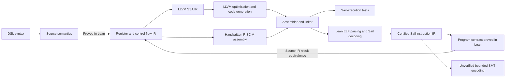

# riscvc

A small Lean 4 DSL for writing 64-bit functions with conditionals, recursion,
and typed structs with mutable heap fields,
proving properties of them, and compiling through LLVM IR to optimised machine
code. A handwritten RISC-V assembly backend is also available.

The source compiler is proved against an internal register/control-flow IR.
The LLVM backend translates that IR into SSA values, basic blocks, and phi
nodes, leaving optimisation and machine details to LLVM. The general compiler
proof ends at the internal IR. A reusable binary lifter now generates an
addressed Sail instruction IR and Lean certificates connecting it to actual ELF
bytes. Program contracts can then be proved in Lean and transferred to the
binary. **`count_up` and the conditional `choose` have end-to-end proofs against
our source IR.** An optional bounded SMT checker supports the integer subset;
its translation is not yet Lean-verified. LLVM itself remains an untrusted code
producer. Integration tests also use the neighboring `sail-riscv` emulator.

The `riscv_mem` extension implements mutable structs and linked-list append.
Append has a Lean proof of termination, concatenated contents, and preservation
of unrelated heap cells. Its LLVM output runs in the Sail emulator and has a
certified lift. **The append source theorem is not yet transferred to its binary:**
the aligned-cell heap model still needs a proved relation to Sail data memory.

## Write a program and prove it

```lean
import Riscvc

open Riscvc

def roundTrip : Expr 2 := [riscv| fun x y =>
  let sum := x + y;
  sum - y
]

theorem roundTrip_correct (x y : Word) :
    roundTrip.eval (Env.two x y) = x := by
  change x + y - y = x
  exact BitVec.add_sub_cancel x y

-- The same property holds for the compiled register program.
theorem roundTrip_compiled (x y : Word) :
    execute roundTrip (Env.two x y) = x := by
  rw [execute_correct]
  exact roundTrip_correct x y

#eval execute roundTrip (Env.two 40 2) -- 40
#eval LLVM.emit "round_trip" roundTrip
```

`Expr 2` means a function with two word arguments. `Word` is `BitVec 64`, so the
proof above includes overflow. A theorem about unbounded natural-number addition
needs a no-overflow premise; see `sum_noOverflow` in
[Riscvc/Examples.lean](Riscvc/Examples.lean).

Conditionals, locals, bitwise operators, and shifts use ordinary expression syntax:

```lean
def maxUnsigned : Expr 2 := [riscv| fun x y =>
  if x < y then y else x
]

def rotateLeft : Expr 2 := [riscv| fun x amount =>
  (x << amount) | (x >> (64 - amount))
]
```

The checked examples also prove unsigned maximum, XOR cancellation, and
idempotence of a byte mask. For specifications with assumptions, use
`Expr.Satisfies program pre post`; `compiled_satisfies` transfers such a proof to
the compiled register program.

## Conditionals and recursion

Use `riscv_rec` to define a self-recursive function. Conditionals in its body
compile to branches, and only the selected arm runs:

```lean
def sumTo : RecFn 1 := [riscv_rec| fun sumTo n =>
  if n then n + sumTo(n - 1) else 0
  termination_by n
]

def countUp : RecFn 2 := [riscv_rec| fun countUp n acc =>
  if n then countUp(n - 1, acc + 1) else acc
  termination_by n
]

#eval sumTo.eval (Env.one 10)             -- 55
#eval countUp.execute (Env.two 10 20)     -- 30
#eval LLVM.emitRecursive "sum_to" sumTo
```

`termination_by n` selects the argument's unsigned natural value as a measure.
Lean checks that every reachable recursive call decreases it. Guarded countdowns
by one are proved automatically. An unguarded `sumTo(n - 1)` is rejected because
zero would wrap to the largest word; `sumTo(n)` is rejected when reachable.
There is no fuel parameter, runtime termination check, or proof data in the
assembly.

`sumTo` needs its recursive result for the addition, so the initial IR contains
an ordinary call. `countUp` returns its call directly, so the LLVM emitter makes
a loop with phi nodes for the next arguments. This guarantees that tail
iterations do not add call frames even at `-O0`, including functions with
stack-passed arguments. Tail position is recognized through `let` and `if`.
Argument updates are simultaneous, so permutations such as `loop(n - 1, y, x)`
work. LLVM may simplify either function further during optimisation.

Prove properties about `RecFn.eval` using the unfolding theorem `RecFn.eval_eq`
and induction on the measure. `RecFn.execute_correct` transfers the result to
the compiled recursive IR. [Riscvc/RecursiveExamples.lean](Riscvc/RecursiveExamples.lean)
proves, for every word input:

```lean
countUp.eval (Env.two n acc) = n + acc
countUp.execute (Env.two n acc) = n + acc
sumTo.eval (Env.one n) = triangle n.toNat
```

Here `triangle` sums into a 64-bit word, including wraparound. For a complete,
editable definition, induction proof, and assembly exporter, see
[examples/Recursive.lean](examples/Recursive.lean).

An optional `decreasing_by` block supplies a custom termination proof; the
default tactic is `word_decreasing`. The surface `termination_by` currently
accepts one argument name. For another natural-valued measure, construct
`RecFn` with `body`, `measure`, and `decreasing` fields directly; a `riscv_rec`
quotation without `termination_by` produces the raw `RecExpr` body.

## Build and use LLVM

Requires the pinned Lean **4.35.0** toolchain through Elan. There are no external
Lean package dependencies.

```sh
lake build
lake test
lake exe riscvc --list
lake exe riscvc --llvm count_up > count_up.ll
lake exe riscvc --llvm --all > examples.ll

# Optimise and verify the LLVM IR.
opt -S -passes='default<O2>' -verify-each count_up.ll -o count_up.opt.ll

# Generate RISC-V assembly; the target is chosen here, not in the DSL.
llc -mtriple=riscv64-unknown-elf -mattr=+m -target-abi=lp64 \
  -code-model=medium -O=2 count_up.opt.ll -o count_up.S

# Or compile for the host using Clang.
clang -O2 -c count_up.ll -o count_up.o
```

These commands are tested with LLVM/Clang **14.0.0** installed locally. The emitted
word-only LLVM IR contains no physical register names, fixed frame sizes, pointer
types, or target triple. The heap extension uses LLVM pointer types and requires
a 64-bit target. The RISC-V example selects RV64IM/LP64: optimisations may introduce
multiplication, even though the source DSL has no multiplication operator. The
medium code model supports the Sail harness's placement at `0x80000000`.

LLVM handles constant folding, algebraic simplification, dead code, register
allocation, spilling, instruction selection, and stack layout; see its
[optimisation passes](https://llvm.org/docs/Passes.html) and
[code-generation tool](https://llvm.org/docs/CommandGuide/llc.html). In the checked
examples, `round_trip(x, y)` becomes a single LLVM return of `x`, and the entire
`count_up(n, acc)` loop becomes one addition. On RISC-V, the latter is just
`add a0, a1, a0` followed by `ret`. These are observed results from the installed
toolchain, not guarantees about every LLVM version.

Unlike the handwritten emitter, this backend has no fifteen-register or
eight-argument restriction. Tests include nine-argument functions and recursion.
Ordinary recursion still requires enough physical stack unless LLVM removes it;
mathematical termination alone does not establish a physical stack bound.

The command-line program exposes `Riscvc.Examples.examples` and
`Riscvc.RecursiveExamples.examples`. Add a definition there to expose another
example, or call `LLVM.emit` / `LLVM.emitRecursive` from a Lean program. Both
return `Except String String`. Concatenating emitted function definitions makes
a module. The original commands without `--llvm` still select the handwritten
assembly backend.

For a complete example of compiling your own file:

```sh
lake env lean --run examples/Custom.lean --llvm > custom.ll
clang -O2 -c custom.ll -o custom.o
lake env lean --run examples/Recursive.lean --llvm > recursive.ll
clang -O2 -c recursive.ll -o recursive.o
```

## Handwritten RISC-V backend

```sh
lake exe riscvc count_up > count_up.S
lake exe riscvc --all > examples.S
```

This backend produces GNU/LLVM-compatible RV64I assembly. Functions accept up to eight 64-bit
integer arguments in `a0` through `a7`, return a word in `a0`, and use only the
fifteen caller-saved argument/temporary registers. The original `Expr` backend
emits leaf functions without stack frames. The `RecFn` backend uses a 128-byte,
16-byte-aligned frame, saving the return address and preserving live slots
across calls. Tail recursion uses one frame; ordinary recursion uses another
frame per active call. Callers must provide an aligned writable stack with
enough space for that depth. Mathematical termination does not establish a
physical stack bound. For example, a C declaration
`uint64_t sum_to(uint64_t)` uses the generated symbol with the RV64 LP64 integer
calling convention.

## Language semantics and current limits

- Operators: `+`, `-`, `&`, `|`, `^`, `<<`, `>>`, and unsigned `<`.
- Arithmetic wraps modulo 2^64. Right shift is logical. Shift counts use their
  low six bits, matching RV64 register shifts; shifting by 64 shifts by zero.
- `<` returns the word 0 or 1. An `if` treats any nonzero condition as true.
- Literals must fit in 64 bits. Decimal and hexadecimal literals are accepted.
  Write `0 - 1` or `0xffffffffffffffff` for the all-ones word.
- `let` is lexically scoped and allows shadowing. Unknown variables and duplicate
  argument names are rejected during Lean elaboration.
- In the original `riscv` expression compiler, both branches are pure and total.
  It evaluates both and selects the result with `sltu`, `sub`, `xor`, and `and`.
  The recursive compiler instead branches around the unselected arm. Pure
  expressions used as recursive-call arguments retain the original lowering.
- Recursion supports self-calls in operands, conditions, and local bindings,
  including multiple calls per expression. Call arguments must be pure: write
  `let x := loop(n - 1); loop(x)` instead of `loop(loop(n - 1))`, and prove the
  appropriate decrease. The recursive function name cannot be shadowed.
- The handwritten backend reuses scratch slots between subexpressions. Functions
  requiring more than fifteen slots are rejected, including staged call
  arguments. The eight-argument ABI limit does not guarantee a function fits
  that pool. There is no spilling yet. Recursive function bodies are also
  limited to 16,384 assembly lines to keep jumps in range. These restrictions
  do not apply to the LLVM backend, which delegates these decisions to LLVM.
- `riscv_mem` adds typed struct pointers, field loads/stores, mutable variables,
  and imperative loops (see below). The original `riscv` and `riscv_rec` forms
  remain pure. Mutual recursion, calls between separate DSL functions,
  multiplication, signed comparisons, and floating point are not implemented.

Proofs are ordinary Lean declarations about `Expr.eval` or `RecFn.eval`. There is no runtime
proof data or automatic extraction of arbitrary Lean functions: the quoted DSL
elaborates to a small, explicit syntax tree, with a precisely defined evaluator.

## Structs, heap operations, and linked-list append

```lean
import Riscvc
open Riscvc.Heap

riscv_struct Node { value : u64, next : ptr Node }

def append := [riscv_mem|
  fun (xs : ptr Node) (ys : ptr Node)
  locals (cur : ptr Node) (next : ptr Node) => {
    cur := xs;
    if xs {
      next := cur.next;
      while next {
        cur := next;
        next := cur.next;
      };
      cur.next := ys;
    } else {};
    return if xs then xs else ys : ptr Node
  }]

#eval LLVM.emit "list_append" append
```

This joins two existing lists in place. Empty lists are null pointers; a nonempty
first list retains its head, and only its last `next` field changes. No allocator
or recursion stack is needed. Fields are eight bytes, laid out in declaration
order, with eight-byte alignment: `Node.value` is at offset 0, `Node.next` at 8,
and the node size is 16. Supported field types are `u64` and nominal `ptr Struct`.
Inline nested structs, arrays, allocation/free, and struct values passed by value
are not implemented. Struct pointer identity and field types are checked by Lean.

The quotation supports field reads, field assignment, local assignment, `+`,
`-`, `==`, conditionals, and `while`. Arguments and locals have fixed declared
types; locals start at zero/null. Conditions accept words or pointers and test
for zero. Branch expressions evaluate only the selected arm, so guarded pointer
reads are safe. Calls/recursion in `riscv_mem` are not implemented; traversal uses
a structured loop. Heap programs compile through the LLVM backend.

[Heap.Language](Riscvc/Heap/Language.lean) defines a partial heap of aligned
eight-byte cells, addressed by byte offset. Null, unaligned, wrapping, or unmapped
accesses fail. `Exec` is an inductive execution relation with no unrolling bound;
`Function.Evaluates` adds function arguments and the returned value. The executable
`Function.run` interpreter takes fuel for testing and distinguishes invalid
access from fuel exhaustion. No fuel or dynamic memory checks are emitted by
LLVM; valid memory accesses must follow from the caller's contract.

[AppendProof.append_correct](Riscvc/Heap/AppendProof.lean) proves the actual quoted
program for arbitrarily long finite lists. `ListRep` describes their addresses,
values, and links; a duplicate-free combined footprint states exclusive ownership
and disjointness. The theorem proves termination, the returned head, the same
nodes and values in `xs ++ ys` order, and preservation of every cell outside the
first list. It uses only Lean's standard axioms. Proofs and ghost node lists are
absent from emitted code.

```sh
lake build Riscvc.Heap.AppendProof
lake exe riscvc --llvm list_append > list_append.ll
python3 scripts/test_heap.py
python3 scripts/lift_binary.py --example list_append --output build/lifted-list-append
```

The scripts handle LLVM 14's opaque-pointer switches automatically. For manual
commands with that version, add `-opaque-pointers` to `opt`/`llc`, or
`-mllvm -opaque-pointers` to `clang`. LLVM 15 and newer default to opaque pointers.
Memory code uses LLVM [load/store and pointer operations](https://llvm.org/docs/LangRef.html#memory-access-and-addressing-operations).

Tests cover empty/singleton/scattered/long lists, all payloads and links, unrelated
memory, invalid accesses, cyclic-list interpreter exhaustion, frontend type
errors, native O0/O2 execution, and RV64 O0/O2 execution in Sail with ABI checks.
The lifter supports `ld`/`sd` and proves their decoding and execution transfer
using Sail's semantics. The SMT checker deliberately rejects memory instructions.
The remaining proof obligation for **end-to-end append binary equivalence** is
to relate the source heap to Sail's byte memory and prove the function contract
over the lifted loop, including memory permissions and immutable code. Neither
runtime tests nor a lifting certificate discharge that obligation.

## What is proved



More precisely, [Riscvc/Correctness.lean](Riscvc/Correctness.lean) proves:

1. `compile_correct`: for every expression, valid local-register mapping, and
   initial register state, compilation returns the source result and preserves
   every register below the destination. Scratch registers can initially hold
   arbitrary values.
2. `execute_correct`: `execute program args = program.eval args` for all programs
   and arguments, in the register-machine semantics.
3. `compiled_satisfies`: source pre/postcondition proofs transfer to that execution.

[Riscvc/ControlCorrectness.lean](Riscvc/ControlCorrectness.lean) additionally proves:

1. `compileRec_correct`: branches and calls preserve expression results and
   the caller's lower slots, for an arbitrary recursive-call implementation.
2. `compileTail_correct`: replacing tail calls with terminal jumps preserves
   results in the structured IR.
3. `RecFn.execute_correct`: the closed compiled recursive function computes the
   same result as its source, by well-founded induction. Its recursive calls
   execute the compiled body again.
4. `RecFn.compiled_satisfies`: recursive source specifications transfer to that
   execution.

The compiler proof and example proofs use Lean's kernel-checked reasoning, with
no `sorry`, custom axioms, or `native_decide`. `lake test` audits the compiler
theorems' axiom dependencies as well as frontend and backend rejection cases.
The register model has unbounded slot indices and a `li` operation with
pseudoinstruction semantics. Its call operation preserves caller slots by
definition; SSA values survive calls in the LLVM lowering, while physical stack
save/restore implements this contract in the handwritten emitter.
Rendering slots as physical registers, branch offsets, stack memory, the return
sequence, `li` expansion, instruction encoding, instruction fetch, and behavior
under traps are outside these theorems.
The LLVM lowering and LLVM's optimisation/code generation are outside those
general theorems. Binary validation bypasses those stages: the reusable lifting
theorem connects decoded execution to the ELF, and a program-specific contract
connects its result to the source IR. Such contracts are currently proved for
`count_up` and `choose`; lifting certificates alone, bounded SMT checks, and
emulator integration tests are distinct from those end-to-end Lean proofs.

The LLVM emitter explicitly masks shift counts with 63 before `shl`/`lshr`,
because LLVM treats oversized shifts as poison. Arithmetic is emitted without
`nsw`/`nuw`, preserving the DSL's modular arithmetic. These details follow the
[LLVM language reference](https://llvm.org/docs/LangRef.html#bitwise-binary-operations).

## Check against your Sail model

The integration test uses the built emulator at
`../sail-riscv/build/c_emulator/sail_riscv_sim`. It reads that checkout without
modifying or rebuilding it. Also requires Python 3, Clang with RISC-V support,
and LLD.

```sh
# LLVM IR verification, native execution, and Sail, at both O0 and O2:
python3 scripts/test_llvm.py
# Native execution and IR verification only:
python3 scripts/test_llvm.py --skip-sail

# Handwritten assembly backend:
python3 scripts/test_sail.py
# Or select another existing emulator:
python3 scripts/test_sail.py --sail /path/to/sail_riscv_sim
```

The LLVM suite checks **6,733 cases per configuration**: native execution and
bare-metal RV64IM execution in Sail, each at O0 and O2. It includes the original
corpus plus register-pressure cases, nine-argument ordinary and tail recursion,
and nested branch joins feeding later computations. LLVM's verifier checks the
emitted SSA, and an optimisation check confirms that `round_trip` becomes a
single return. LLVM, Clang, LLD, Python 3, and the existing Sail emulator are
required; `--skip-sail` needs only Clang, `opt`, and Python in addition to Lean.

The handwritten suite compiles a bare-metal RV64I ELF and runs it in Sail. It has
6,395 cases across 20 examples, 32 generated functions, and a large-branch
regression. Expected differential results come from the Lean source evaluator;
the deep tail-loop case checks its proved arithmetic specification. Tests include overflow, unsigned comparisons
across the sign bit, non-Boolean conditions, masked shift counts, full-width
constants, nested locals and selections, all physical register slots, and
deterministically generated expressions, saved locals across recursive calls,
multiple calls, recursive conditions, and permuted tail-call arguments. A
10,000-step tail loop checks a canary below its frame to detect stack growth.
The harness also checks preservation of `sp`, `gp`, `tp`, and `s0` through `s11`.
Build artifacts go in `build/`.

## Lift binaries and prove program contracts

```sh
# Compile a DSL example, lift its instructions, and check the lifting certificate:
python3 scripts/lift_binary.py --example choose --output build/lifted-choose

# Also prove source-IR equivalence for every input, including both branch paths:
python3 scripts/lift_binary.py --example choose \
  --proof-module Riscvc.Binary.Choose --output build/lifted-choose

# Check the manual proof module independently of any generated ELF:
lake build Riscvc.Binary.Choose

# Lift an existing static ELF, optionally selecting a function symbol:
python3 scripts/lift_binary.py --elf /path/to/program.elf --symbol my_function

# Replay the complete generated proof without invoking LLVM or the lifter:
lake env lean --tstack=131072 build/lifted-choose/Lifted.lean
```

The output contains `program.json` (addresses, encodings, decoded operands, and
Sail AST constructors), `Lifted.lean` (complete ELF bytes and proofs), and an
axiom audit. The lifter currently supports RV64 integer register/immediate
arithmetic, logical operations, comparisons, shifts, the 32-bit word forms,
upper immediates, all six integer conditional branches, `jal`/`jalr`, and
64-bit integer loads/stores (`ld`/`sd`). Compressed instructions, other memory operations, system instructions, and extension
instructions are rejected. `--symbol` selects a function's address range; the
Lean obligations check the actual addresses and bytes, not the symbol's name.

The binary and source use different IRs for a reason: our source IR has virtual
registers and structured calls; the decoded IR retains physical registers, PCs,
and machine control flow. Its instruction type is **Sail's own instruction AST**,
and its executor calls Sail's generated semantics. There is no second
handwritten ISA semantics in the Lean proof path.

The proof has three layers:

1. For every proposed node, Lean checks that its raw word occurs at its address
   in the ELF's executable load segments, and proves that Sail decodes it to the
   proposed instruction under the stated machine configuration. Python's parser
   and decoder are untrusted certificate producers.
2. [Lifted.run_correct](Riscvc/Binary/Lifted.lean) proves once that every successful
   execution of a certified lifted program is the **same full Sail-state
   transition** as execution of the bytes. It is independent of instruction
   count, entry address, and control-flow shape. Each lifted step checks the
   configuration; missing targets, exceptions, and non-retirement fail rather
   than being treated as successful termination.
3. A user writes a regular Lean module exporting
   `contract : Riscvc.Binary.Lifted.Contract`. It contains the expected `program`,
   `pre`, `post`, and `correct : Hoare program pre post`. `Hoare` requires a finite
   successful execution and the stated postcondition for every allowed starting
   state. The generator imports the module, proves `program = contract.program`,
   and applies `Lifted.transfer` to produce
   `equivalent : BinaryHoare image contract.pre contract.post`. The postcondition
   can refer directly to `Riscvc.execute` / `RecFn.execute`, connecting to the
   existing source-IR compiler correctness theorems.

`--proof-module Riscvc.MyProof` builds and imports that module and uses
`Riscvc.MyProof.contract`. Proof files have their own imports and namespaces;
Lake and the Lean editor can check them independently. Generated certificates
refer to the imported theorem rather than pasting in source fragments. The
program equality checks addresses, instruction words, and Sail ASTs, so a proof
for different code is rejected. `--import Riscvc.MySpec` remains available for
additional imports and is repeatable.

**A certified lift is not itself a source-equivalence proof.** With no `--proof-module`,
the tool certifies decoding and execution transfer only. The
[choose proof](Riscvc/Binary/Choose.lean) demonstrates the additional
semantic argument: all 64-bit inputs, both paths, the correct return address,
unchanged memory, and preservation of registers other than `a0`, `a2`, and the
PC registers. It is a proof for LLVM's current `choose` code layout; a compiler
change may require updating this manual proof even when the code remains correct.

For loops, `Lifted.loop` provides a well-founded induction rule. Supply an
invariant at chosen instruction boundaries, a natural-number measure, and a
proof that each segment preserves the invariant while decreasing the measure.
The resulting theorem supplies a finite execution length; there is no fixed
unrolling bound. Invariant discovery, stack-frame reasoning for ordinary
recursion, and automatic source/binary state-relation discovery are not yet
implemented. Direct and indirect control transfers are represented faithfully;
that representation does not itself establish a function-call contract.

The same instruction-level boundary as the original binary prototype applies:
machine-mode RV64I, `mseccfg = 0`, immutable executable text mapped as stated,
and explicit ABI preconditions in the program contract. This is not a proof of
Sail's full fetch/MMU/interrupt/boot loop. The existing pinned model, upstream
platform declarations, filesystem ingestion, and axiom audit are described below.

## Bounded SMT checks

```sh
lake exe riscvc --smt choose > build/lifted-choose/spec.smt2
python3 scripts/check_lifted_smt.py build/lifted-choose/program.json \
  --spec build/lifted-choose/spec.smt2 --steps 4 --run

# Run the lifting, manual-proof, SMT, and negative regression tests:
python3 scripts/test_lifting.py
```

The SMT tool rechecks the manifest against the ELF and emits an SMT-LIB query
using bitvectors and a register array. It explores all paths up to the bound,
including indirect control transfers. It asks whether any permitted initial
state either returns a wrong value, changes a callee-saved register, traps on
instruction alignment, reaches a missing target, or fails to return to the
original `ra` within the bound. Initial `ra` must be four-byte aligned and
outside the lifted instructions. `x0` is always zero; shift masking, sign
extension, and arithmetic wraparound are modeled explicitly.

`unsat` means no such execution exists **under the SMT encoding and contract**.
`sat` can mean a counterexample or an insufficient bound; the tool prints inputs
and completion/failure indicators. `unknown`, timeouts, and solver errors never
verify. Bounds are not silently assumed sufficient, and a bounded check of a
loop must not be described as an unbounded proof.

The specification file defines `expected`, and optionally `requires`, using the
initial argument registers `a0` through `a7` (or `r1` through `r31`):

```smt2
(define-fun expected () (_ BitVec 64) (bvadd a0 a1))
(define-fun requires () Bool (bvule a0 (_ bv3 64)))
```

Omitting `requires` means `true`. `riscvc --smt` exports pure DSL examples;
recursive functions need a separately supplied mathematical specification.
The contract parser permits only these definitions, not solver commands or
hidden assertions.

**The SMT exporter and its instruction-to-formula translation are unverified.**
They are a separate exploration/checking route; `unsat` is never substituted for
a Lean proof, and the tool does not label it a Sail equivalence certificate.
To make that route produce the same guarantee as `--proof-module`, the SMT lowering
would need a proved connection to Sail and the solver evidence would need to be
checked or reconstructed in Lean. The manual Lean route already checks the
entire semantic chain without trusting LLVM, Python, or an SMT result for the
mathematical theorem; associating the theorem's byte literal with a disk file
still uses ordinary filesystem I/O.

## The original count_up binary proof

```sh
python3 scripts/verify_binary.py --negative-tests

# Validate an existing executable against the same count_up specification:
python3 scripts/verify_binary.py --elf /path/to/count_up.elf

# Replay the generated certificate directly:
lake env lean --tstack=131072 build/binary-proof/Certificate.lean
```

The driver emits the DSL function's LLVM IR, runs O2, compiles to RV64 machine
code, and links a static ELF. LLVM turns the recursive function into:

```asm
add a0, a1, a0
ret
```

The certificate contains the **entire ELF file as a byte literal**.
[ELF.lean](Riscvc/Binary/ELF.lean) checks the ELF64 little-endian RISC-V header,
load segments, execute permissions, address bounds, and entry point. It rejects
dynamic executables and overlapping load segments. Lean fetches the instruction
words from that image; `objdump` is used only to save a readable disassembly.

[CountUp.correct](Riscvc/Binary/CountUp.lean) proves that these bytes, decoded and
executed with Sail, return `countUp.execute (Env.two n acc)` for **every pair of
64-bit inputs**, including wraparound. The existing source/IR correctness
theorem connects that result to the recursive DSL function. The binary returns
after two instructions, reaches the caller's return address, and preserves
memory and registers other than `a0`, `PC`, and `nextPC` in the instruction model.

The explicit preconditions are a loaded, immutable executable text image,
entry address `0x80000000`, arguments in `a0/a1`, a four-byte-aligned return
address in `ra`, machine privilege, `misa = 0x8000000000000100` (RV64I), and
`mseccfg = 0`. The [harness](Riscvc/Binary/Sail.lean) delegates decoding,
instruction effects, and PC commit to Sail. It models successful instruction
fetch directly from the checked image. It does **not** yet prove Sail's full
MMU, interrupt, retirement-counter, or boot loop. `TextLoaded` relates the image
to Sail memory, and the theorem preserves that relation.

This original driver is a validator for **this code shape and specification**.
Different instructions, entry addresses, or programs fail its certificate
check; use the generalized lifting workflow above for other code. The negative
tests change `add` to `sub`, corrupt `ret`, change the ELF machine type, and move
the entry point. Residual loops need invariants; ordinary recursion additionally
needs stack and call proofs.

Artifacts are in `build/binary-proof/`: the ELF, LLVM IR before/after O2,
disassembly, full-byte Lean certificate, and axiom audit. File ingestion and
artifact identity use ordinary filesystem I/O; the printed SHA-256 identifies
the bytes submitted to Lean. ELF parsing and the semantic proof run inside
Lean's kernel. The audit rejects `sorry`, native-evaluation proof axioms, and
unexpected axioms. It allows Lean's three standard axioms and four upstream
Sail platform declarations (`load_reservation`, `match_reservation`,
`plat_term_write`, `sys_enable_experimental_extensions`), referenced by the full
model but not invoked along the proved integer/return path.

The generated Sail sources and support library are vendored, so normal proof
checking needs no network or Sail installation. See
[model provenance](vendor/sail-riscv/PROVENANCE) and
[support provenance](vendor/lean-sail/PROVENANCE). The model is pinned to
`b7d13572fcd4a87d0999eb6303652cd05a47881e`, immediately before the published
August 2026 Lean model, with Zicfilp disabled. The newer local checkout exposes
unsupported trigger-register types and virtual-memory termination obligations
in the Lean backend. Regenerate from the local checkout's Git history with
Sail 0.20.3 using `python3 scripts/setup_sail.py --regenerate`; the source checkout
is never modified. The generated definitions only receive a syntactic
qualification of `assert` to avoid Lean 4.35's new keyword.

Further systems-language work includes a proved relation from the typed heap to
Sail data memory, reusable separation/frame rules, allocation, calls between heap
functions, and verified stack spilling. Keeping source semantics independent
of Sail allows program proofs to remain small while the backend proof handles
machine details.

Lean's [bitvector documentation](https://lean-lang.org/doc/reference/latest/Basic-Types/Bitvectors/)
is a useful reference for proving additional word-level properties.
